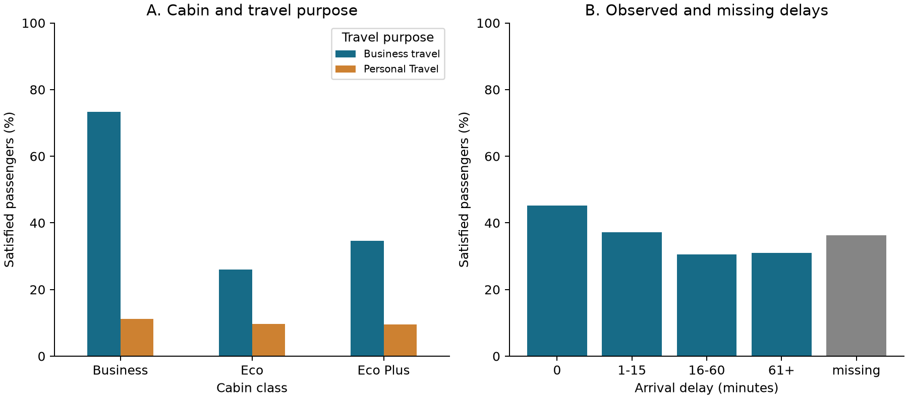
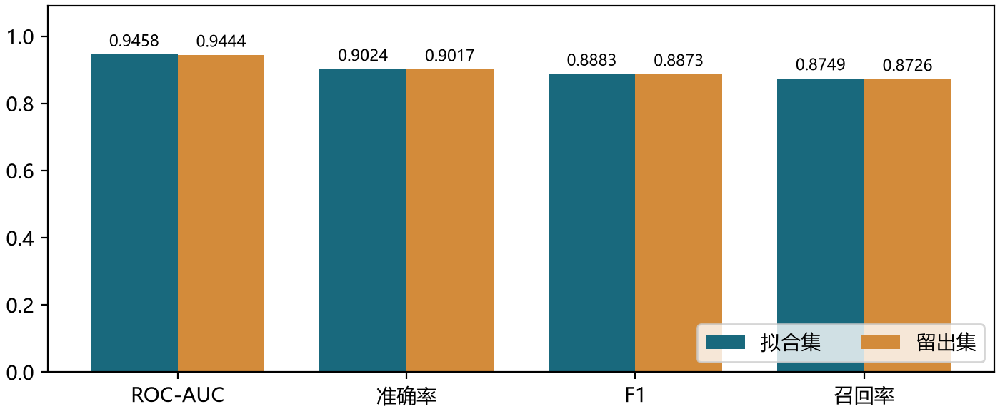
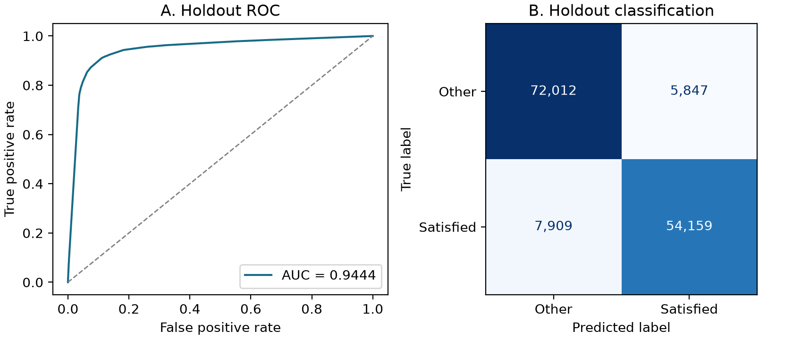
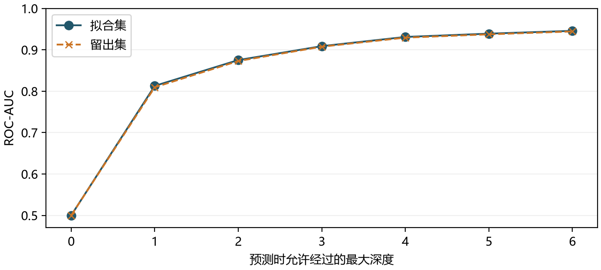
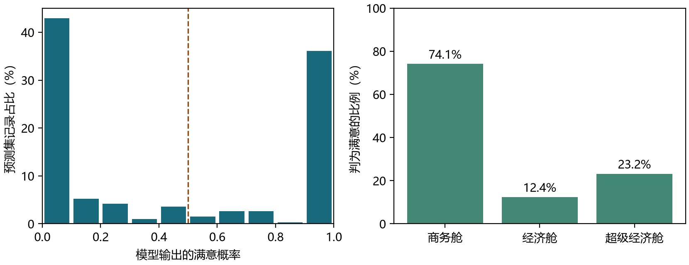

# 航空旅客满意度的数据管理、预测与可视化分析

**摘要**　航空服务记录可以回答两类问题：已有评价的旅客中有多少人满意，尚无评价的旅客中有哪些人更可能满意。本文以这两类记录为对象，建立从获取数据、清洗入库到模型训练、批量预测和图表核对的流程。999,479 条记录以统一主键存入 SQLite，保留了 422 条到达延误未知的记录。采用单棵决策树对满意度建模，拟合集与留出集的 ROC-AUC 分别为 0.9458 和 0.9444。对其余 299,844 条记录逐条评分，以 0.50 为阈值，共有 129,135 条被判为满意。本文分别展示已观测的满意率、两组已知标签上的模型表现，以及无标签记录中的预测分布，使图中每个比例都能追溯到相应的数据和分母。

**关键词**　数据清洗；关系数据库；决策树；分类预测；数据可视化

## 一、获取数据与界定分析对象

如果航空公司先收到旅客的服务评分，稍后才取得总体满意评价，可以先用已有评价探索记录之间的差异，再训练模型给其余记录排序。本研究用公开合成数据演示这一工作过程。数据来自 Kaggle Playground Series S6E10 的官方压缩包。原始文件中的一行代表一条旅客记录，包含年龄、舱位、行程、起降延误和 13 项服务评分等 21 个可用特征。

取得数据后，程序为两个 CSV 分别计算 SHA-256，并记录输入行数。标有满意度的文件用于描述与建模，其中再划分拟合集和留出集；另一文件共 299,844 行，用于演示批量预测。训练时只使用拟合集学习规则，留出集用于检查规则在未参与拟合的记录上表现如何。这个区分决定了后文哪些图可以展示准确率，哪些图只能展示预测概率或类别比例。

## 二、清洗数据与保留缺失信息

每批读取 50,000 行，先核对列名，再整理数值和类别字段。评分必须为 0 至 5 的整数，航程与延误必须是非负整数。对文本去除首尾空格后，检查舱位等类别是否属于约定集合。总体满意标签由 True、False 编码为 1、0，以便统计满意人数。服务评分 0 属于原编码，因而予以保留。

| 数据来源 | 输入行数 | 入库行数 | 到达延误缺失 | 已知满意标签 |
|---|---:|---:|---:|---:|
| 有标签文件 | 699,635 | 699,635 | 292 | 699,635 |
| 待预测文件 | 299,844 | 299,844 | 130 | 0 |

延误为 0 表示实际记录为零分钟；缺失只表示分钟数未知。明细表用 NULL 保存未知值，绘制原始分组图时单列缺失组。训练阶段再根据拟合集估计中位数进行填补，并增加缺失指示变量。这使描述统计可以保留原始含义，模型也能接收完整的数值输入。

## 三、数据存储与管理

实验保留三个层次的数据。原始 CSV 用于追溯来源；SQLite 中的 responses 表保存清洗后的明细；汇总 CSV、预测文件和图形用于分析与交付。单机数据库可以容纳本次约百万行的结构化记录，也便于按照相同条件反复查询。每次重建时，程序先向临时数据库分批写入，通过核验后再替换当前数据库。

| 数据对象 | 主键或粒度 | 管理办法及用途 |
|---|---|---|
| 原始输入 | 每个来源文件 | 留存原始文件，quality.json 记录文件指纹、输入及入库行数 |
| responses 明细表 | 每个 id 一行 | id 为整数主键，跨来源重复会触发约束；split 标记来源 |
| 标签和延误字段 | 每条旅客记录 | 训练行标签仅允许 0 或 1，待预测行标签必须为空；到达延误允许为空 |
| 预测明细 | 每个待预测 id 一行 | tree_predictions.csv 单独保存 id 和满意概率，可按 id 回连舱位并复算各组数量 |

在 split、舱位和出行目的上建立组合索引。分析已观测满意率时，查询限定 split 为 train，再按舱位与出行目的分组，以组内标签之和除以组内行数。训练模型时仅提取有标签记录，预测时用相同特征读取另一来源。程序逐来源核对行数、空延误数和已知标签数，并执行数据库完整性检查。对输出另做逐 ID 核对，299,844 个预测标识符与原始待预测文件一一对应。

## 四、用有标签数据训练模型

依据课程第 6 章第 6.2.2 节，选用可逐层解释的决策树。对 699,635 条有标签记录按满意标签分层抽取 80% 拟合，余下 20% 留出，随机种子为 42。标识符只用于回连。类别字段独热编码，中位数和编码器均在拟合记录上确定，再用于留出与待预测记录。

决策树以熵下降选择二叉切分，最大深度设为 6，每个叶节点至少包含 200 条拟合记录。得到的树共有 58 个叶节点。模型首先根据在线登机评分是否高于 3.5 切分。对于打 0–3 分的旅客，下一层检查机上 Wi-Fi 评分；对于打 4–5 分的旅客，下一层检查出行目的。一条记录抵达叶节点后，该叶内拟合记录的满意比例即为其预测分数。分数相同的旅客可能来自同一叶节点。

## 五、对无标签数据生成预测

固定上述预处理器和决策树，把 299,844 条无标签记录逐条送入模型。保存的两列分别为 id 和满意概率；该输出文件的 satisfaction 列存储概率。以 0.50 为阈值可进一步得到预测类别。例如 id 699635 的预测概率是 0.2805，判入其他类；id 699636 的预测概率是 0.8425，判为满意。模型和预处理器共同保存，重载后抽查前 100 条记录，概率与保存前一致。

平均预测概率与判为满意的比例回答不同的问题。前者对所有分数取平均，后者先对单条记录按阈值分类，再统计正类占比。所有预测记录的平均分为 0.4437，判为满意的记录占 43.07%。以下同时保留这两种口径，供分组解读。

## 六、可视化分析与结果解释

### 6.1 原始观测中的分组差异

**图 1**　有标签记录的组内实际满意率。左图按舱位和出行目的分组，右图将延误缺失单列。纵轴按每组实际满意人数除以该组有标签记录数计算。

商务舱总体满意率为 72.53%，经济舱为 16.76%。拆开出行目的后，两舱在商务出行组相差 47.24 个百分点，在私人出行组只相差 1.49 个百分点。构成上的差异有助于解释这一现象：商务舱旅客中商务出行占 98.85%，经济舱中该比例为 43.25%。右图中，292 条延误缺失记录的满意率为 36.30%，而 640,415 条零延误记录为 45.21%。若将两者合并，数据清洗过程会掩盖这一差异。

### 6.2 拟合质量与留出误差

拟合集用于学习树的切分规则，留出集有已知标签且未参与拟合，用于核对预测。评价时将“满意”定义为正类。随机各取一名满意旅客和一名其他旅客，ROC-AUC 表示模型把满意旅客排在前面的概率，同分按半次计。准确率是全部旅客中判对的比例。精确率的分母是模型判为满意的人数，召回率的分母是实际满意的人数。留出集上这两项分别为 90.26% 和 87.26%。F1 是二者的调和平均，本例为 0.8873。

**图 2**　同一棵决策树在 559,708 条拟合记录和 139,927 条留出记录上的表现。ROC-AUC 用于评估排序，另外三项指标按 0.50 阈值计算，F1 和召回率均以满意为正类。

拟合与留出 ROC-AUC 分别为 0.9458 和 0.9444，准确率分别为 90.24% 和 90.17%，相差约 0.07 个百分点。四项指标均在留出集上小幅下降。本次划分中未见明显的拟合与留出差距；这一结果仅反映同一合成数据来源下的一次分层划分。

**图 3**　留出集 ROC 曲线与混淆矩阵。混淆矩阵按行表示真实类别，按列表示预测类别。54,159 名实际满意旅客被正确识别，7,909 名被漏判，另有 5,847 名其他旅客被判为满意。满意类召回率为 87.26%。这解释了为什么总体准确率超过九成，仍会漏掉约八分之一的满意旅客。

### 6.3 决策树拟合效果的逐层分析

**图 4**　固定已训练的树，逐层比较规则的区分能力。横轴是预测时允许从根节点向下走的最大深度，纵轴是 ROC-AUC。两条线分别使用拟合集和留出集的实际标签计算。

单棵决策树一次建树即可完成拟合，没有神经网络训练中反复遍历样本的轮次（epoch）。为观察各层分支的贡献，本文在预测时依次将遍历深度限制为 0 至 6。到达深度上限或提前遇到叶节点时，取当前节点内拟合样本的满意比例作为预测分数。所有深度共用原有的样本划分、预处理和树结构。

深度为 0 时，所有旅客得到相同分数，两组 AUC 均为 0.5000。允许经过第一层在线登机评分切分后，留出 AUC 升至 0.8095；深度 3 时达到 0.9076。第 5 层到第 6 层仍有改善，从 0.9374 增至 0.9444，增幅约 0.0070。前几层规则贡献了较大的排序改善，后续细分的收益趋小。本图用于解释预设深度为 6 的模型，不能据此断定深度 6 最优。

### 6.4 无标签记录的预测分布

**图 5**　左图将待预测记录的分数按宽度 0.1 分箱，纵轴为记录占全部 299,844 条的百分比，虚线为分类阈值。例如分数 0.84 计入 [0.8, 0.9) 区间。右图显示各舱位中预测概率达到 0.50 的比例，分母改为该舱位的待预测记录数。

| 预测对象 | 记录数 | 平均预测概率 | 判为满意的记录数 | 判为满意的比例 |
|---|---:|---:|---:|---:|
| 商务舱 | 146,626 | 0.7218 | 108,712 | 74.14% |
| 经济舱 | 140,220 | 0.1713 | 17,407 | 12.41% |
| 超级经济舱 | 12,998 | 0.2450 | 3,016 | 23.20% |
| 全部 | 299,844 | 0.4437 | 129,135 | 43.07% |

有 128,640 条记录的预测分数低于 0.10，另有 108,152 条达到或超过 0.90，合计占 78.97%。决策树以叶节点内的满意比例计分，有限数量的叶节点会让记录集中在若干分值上。图 5 显示模型对商务舱记录给出的正类比例最高，与图 1 的舱位总体排序一致，但两图的数据来源和分母不同。无标签记录的实测满意率、准确率和这些高分预测的实际命中率，均须取得后续标签才能核验。

## 七、结论与局限

统一主键与来源字段使原始记录、训练样本和逐条预测可以核对。分析实际标签发现，总体舱位差距同时受到出行目的构成的影响。模型在拟合与留出记录上的表现接近，留出误差以漏判满意旅客居多。将同一模型用于无标签记录后，概率分布和分舱位正类比例给出了可核对的输出摘要。实际应用时，应在取得后续满意反馈后按 id 回连预测，检查各概率区间的实际满意率，并评估不同人群中的误差。本研究使用合成数据，观察到的差异不能直接解释为航空服务措施的因果效果。

## 参考资料

1. Kaggle. Playground Series S6E10. [官方数据页](https://www.kaggle.com/competitions/playground-series-s6e10/data)。
2. 《数据科学》课程讲义，第 4 章“数据的采集与预处理”，第 5 章“数据的存储与处理”。
3. 《数据科学》课程讲义，第 6 章“大数据分析方法”，第 6.2.2 节“分类与预测”，第 40–46 页。
4. 《数据科学》课程讲义，第 7 章“大数据分析工具”，第 8 章“大数据可视化”。
